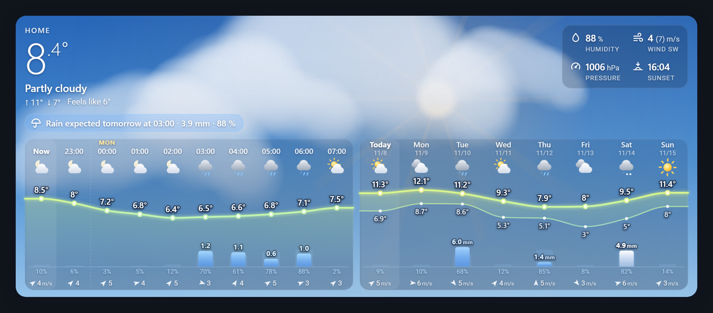
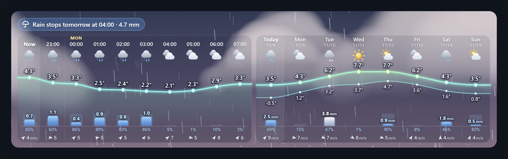
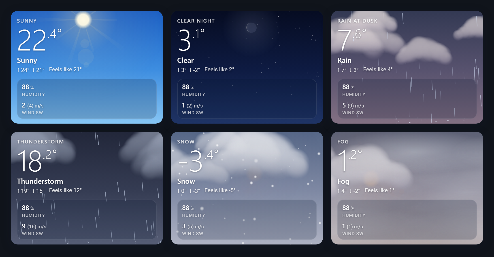

# Skycast Card

[](#installation)
[](https://github.com/em0g/skycast-card/releases/latest)
[](https://github.com/em0g/skycast-card/actions/workflows/validate.yml)
[](LICENSE)

A weather card for Home Assistant with a **living sky** behind an **hourly and daily forecast chart** – and everything is set up in the visual editor.

[](https://my.home-assistant.io/redirect/hacs_repository/?owner=em0g&repository=skycast-card&category=plugin)



- The sky follows the weather and the real position of the sun (`sun.sun`): dawn, day, dusk and night.
- Clouds drifting with the wind, rain with splashes, snow, hail, fog, wind streaks, lightning, stars, shooting stars, a sun with rays and the moon in its current phase.
- Temperature curve coloured by temperature (blue when cold, orange when warm). The daily view shows high/low with a band between them.
- **Precipitation bars** in mm (or probability in %). Snow is drawn white, sleet light blue.
- A rain summary line: *"Rain expected tomorrow at 03:00 · 3.9 mm · 88 %"* or *"Dry until Wednesday"*.
- Hourly and daily as **tabs**, on their own, **side by side** or **stacked** – in one single card.
- Fills the height you give it in the sections view.
- Swedish and English (follows Home Assistant's language). No dependencies – one file.





## Contents

- [Requirements](#requirements)
- [Installation](#installation)
- [Updating and removing](#updating-and-removing)
- [Getting started](#getting-started)
- [Configuration](#configuration)
- [Wall tablets](#wall-tablets)
- [Troubleshooting](#troubleshooting)
- [Support and feedback](#support-and-feedback)

## Requirements

- Home Assistant **2024.10** or newer.
- A **weather entity** that provides an hourly and/or daily forecast, for example from Met.no, SMHI or OpenWeatherMap.
  The card shows the forecast types your entity supports.
- Optional: the `sun.sun` entity (on by default in Home Assistant) for the light of the sky and the sun's position.

## Installation

### Home Assistant 2026.11 or newer – Marketplace (recommended)

Since 2026.11, the community store is built into Home Assistant as the **Marketplace** (it replaced HACS).

**One click:** select the **Open Marketplace repository** button above and follow the steps in Home Assistant.

**Or by hand:**

1. Go to **Settings → Marketplace**. The first time, read the warning and accept it.
2. Select **Add from link** in the upper-right corner.
3. Under **GitHub link**, enter `em0g/skycast-card` and select **Add**. If you are asked for a type, choose **Dashboard**.
4. Open **Skycast Card** and select **Install**, then **Install** again in the dialog.
5. **Reload the browser** (on a wall tablet: reload the page in the kiosk app).

The Marketplace adds the dashboard resource `/local/community/skycast-card/skycast-card.js` for you.

> [!NOTE]
> Skycast Card is not in the Marketplace catalog yet, so it doesn't show up when you search until you have added it with **Add from link**.
> Once it is in the catalog, you can search for **Skycast** and skip steps 2–3.

### Home Assistant 2026.10 or older – HACS

1. Open **HACS** → **⋮** (upper-right corner) → **Custom repositories**.
2. Add `https://github.com/em0g/skycast-card` with type **Dashboard**.
3. Search for **Skycast Card**, select **Download**, then reload the browser.

HACS adds the resource `/hacsfiles/skycast-card/skycast-card.js` for you.
When you upgrade Home Assistant to 2026.11, HACS moves to the Marketplace automatically: the card stays installed and keeps getting updates.

### Manual

1. Download `skycast-card.js` from the [latest release](https://github.com/em0g/skycast-card/releases/latest).
2. Copy it to `/config/www/skycast-card/skycast-card.js`.
3. Go to **Settings → Dashboards → ⋮ → Resources → Add resource**, enter `/local/skycast-card/skycast-card.js` and choose **JavaScript module**.
   (If you don't see **Resources**, turn on *Advanced mode* in your user profile.)
4. Reload the browser.

With a manual install you don't get update notifications; repeat steps 1–2 for each new version and add `?v=1.0.2` (the version) to the end of the resource URL so browsers fetch the new file.

### Dashboards in YAML mode

If you manage resources in YAML, the Marketplace and HACS can't add the resource for you. Add it yourself:

```yaml
lovelace:
  resources:
    - url: /local/community/skycast-card/skycast-card.js # HACS (2026.10 or older): /hacsfiles/skycast-card/skycast-card.js
      type: module
```

## Updating and removing

- **Updates** show up under **Settings → Updates**, next to Home Assistant's own updates. Install them there and reload the browser.
  On a wall tablet, reload the page in the kiosk app (or clear its cache) so the new version loads.
- See what changed in the [changelog](CHANGELOG.md) or on the [releases page](https://github.com/em0g/skycast-card/releases).
- **Remove:** first remove the card from your dashboards. Then, in **Settings → Marketplace**, open **Skycast Card** → **⋮** → **Uninstall**.
  The Marketplace removes the file and the dashboard resource.

## Getting started

1. Edit a dashboard → **Add card** → search for **Skycast**.
2. The card picks your first weather entity. Choose another one under **Weather data** if you have several.
3. Choose a layout under **Forecast – what and how**: tabs, hourly only, daily only, side by side or stacked.
4. In the sections view, resize the card on the **Layout** tab. The card fills the height you give it.

Everything else can be changed in the editor, grouped in sections. At the bottom of the editor you find links to this guide and to bug reports, and the version you are running.

## Configuration

| Section | What you can change |
|---|---|
| **Weather data** | Weather entity, name, language, sun entity |
| **Forecast** | Layout (tabs / hourly / daily / side by side / stacked), width share, number of hours and days, hour step, which rows are shown (times, icons, curve, values, low temperature, now highlight, day separators), precipitation as amount or probability, wind and wind unit |
| **Current weather** | On/off, large or compact style, name, condition, high/low, feels like, decimals, which metrics are shown and in which order, icons, labels, columns |
| **Rain summary** | On/off, threshold, how far ahead to look |
| **Size** | Overall scale, fixed height, padding, temperature size, corner radius, curve and bar height, column width, icon size |
| **Appearance** | Sky visibility, panel strength, curve colour, custom precipitation and text colours |
| **Animation** | On/off, frames per second, amount of clouds, amount of rain/snow, wind effect, day/night, stars, shooting stars, sun rays, splashes, lightning flash, animated icons, chart draw-in |
| **Custom sensors** | Your own sensors for temperature, feels like, humidity, pressure, wind, gusts, wind direction, UV, indoor temperature and humidity |
| **Tap and hold** | Tap and hold actions |

### Size

- **Sections view:** resize the card on the *Layout* tab. The card fills the height – the curve grows when there is room, and when it gets too small the probability, wind and icon rows are hidden one by one.
- **Other views:** use *Fixed card height* and *Scale* in the **Size** section.

### YAML examples

The editor writes the YAML for you. Switch to the code editor in the card dialog to see it, or to paste one of these.

Hourly and daily side by side, without current weather:

```yaml
type: custom:skycast-card
entity: weather.home
show_current: false
forecast_mode: side_by_side
```

Compact header with your own metrics, hourly above daily:

```yaml
type: custom:skycast-card
entity: weather.home
header_style: compact
forecast_mode: stacked
wind_unit: m/s
metrics: [wind, humidity, indoor_temperature, sun]
indoor_temperature_entity: sensor.indoor_temperature
```

Wall tablet: compact header, side by side, lighter animation:

```yaml
type: custom:skycast-card
entity: weather.home
header_style: compact
show_name: false
forecast_mode: side_by_side
max_fps: 20
```

Current weather only:

```yaml
type: custom:skycast-card
entity: weather.home
show_chart: false
metrics: [humidity, wind, pressure, sun, uv_index, visibility]
metrics_columns: 3
```

<details>
<summary>All options</summary>

| Key | Default | Description |
|---|---|---|
| `entity` | – (required) | Weather entity |
| `name` | entity name | Text above the temperature |
| `locale` | `auto` | `auto`, `sv` or `en` |
| `sun_entity` | `sun.sun` | Sky light, sun position and night icons |
| `show_chart` | `true` | Show the forecast |
| `forecast_mode` | `tabs` | `tabs`, `hourly`, `daily`, `side_by_side`, `stacked` |
| `forecast_type` | `hourly` | Tab shown first (`tabs` mode) |
| `split` | `50` | Percent of the width for hourly (`side_by_side`) |
| `stack_below` | `560` | Stack hourly and daily when the card is narrower than this (px) |
| `hours_to_show` / `days_to_show` | `0` | Number of columns, `0` = as many as fit |
| `hourly_step` | `1` | Every n:th hour; precipitation is summed |
| `show_time_labels`, `show_icons`, `show_temperature`, `show_temp_labels`, `show_low_temp`, `show_now_highlight`, `show_day_separators` | `true` | Chart rows |
| `round_temp` | `false` | Whole degrees in the chart |
| `show_precipitation` | `true` | Precipitation bars |
| `precipitation_type` | `amount` | `amount` (mm) or `probability` (%) |
| `show_precip_labels`, `show_probability` | `true` | Values above the bars, probability below |
| `show_wind` | `true` | Wind in the chart |
| `wind_unit` | `auto` | `auto`, `m/s`, `km/h`, `mph`, `kn` |
| `show_current` | `true` | Current weather |
| `header_style` | `large` | `large` or `compact` |
| `show_name`, `show_condition`, `show_hilo`, `show_feels_like` | `true` | Parts of the current weather |
| `temperature_decimals` | auto | 0–2 |
| `show_metrics` | `true` | Metrics box |
| `metrics` | `[humidity, wind, pressure, sun]` | Order and choice of `humidity`, `wind`, `pressure`, `sun`, `feels_like`, `uv_index`, `visibility`, `dew_point`, `cloud_coverage`, `precipitation`, `indoor_temperature`, `indoor_humidity` |
| `show_metric_icons`, `show_metric_labels` | `true` | Icons and labels in the metrics |
| `metrics_columns` | `0` | Columns, `0` = auto |
| `show_nowcast` | `true` | Rain summary line |
| `nowcast_threshold` | `0.1` | mm/h that counts as precipitation |
| `nowcast_hours` | `48` | Hours to look ahead |
| `scale` | `1` | Scale of text and icons |
| `card_height` | `0` | Fixed height in px, `0` = auto |
| `padding` | `14` | Inner padding |
| `temp_size` | `0` | Big temperature size in px, `0` = auto |
| `border_radius` | theme | Corner radius in px |
| `chart_height` | `56` | Temperature curve height |
| `precip_height` | `30` | Precipitation bar height |
| `column_width` | `0` | Minimum column width, `0` = auto |
| `icon_size` | `0` | Weather icon size, `0` = auto |
| `sky_opacity` | `1` | 0–1, lower lets the dashboard background through |
| `panel_opacity` | `1` | 0–2, strength of the dark panels |
| `temp_color_mode` | `gradient` | `gradient` or `fixed` (+ `temp_color`) |
| `custom_colors` | `false` | Enables `precip_color` and `text_color` |
| `animate` | `true` | Animated sky |
| `max_fps` | `30` | Frames per second |
| `cloud_amount`, `precip_amount`, `wind_effect` | `1` | Amount of clouds, rain/snow and wind effect |
| `day_night` | `true` | Light from the sun's position |
| `show_stars`, `shooting_stars`, `sun_rays`, `rain_splash`, `lightning_flash` | `true` | Effects |
| `animated_icons`, `chart_animation` | `true` | Icon animation and chart draw-in |
| `temperature_entity`, `feels_like_entity`, `humidity_entity`, `pressure_entity`, `wind_speed_entity`, `wind_gust_entity`, `wind_bearing_entity`, `uv_entity`, `indoor_temperature_entity`, `indoor_humidity_entity` | – | Custom sensors |
| `tap_action` / `hold_action` | more-info / none | Actions |

</details>

## Wall tablets

- The animation pauses when the card is off screen or the screen is off.
- If the tablet gets warm or slow, lower *Max frames per second* to 20 or turn off *Animated sky*.
- Honours the operating system's "reduce motion" setting.
- Short of height? Use the *Compact* style and turn off the name under **Current weather**, or make the card shorter on the *Layout* tab – it hides rows by itself.

## Troubleshooting

<details>
<summary><b>"Custom element doesn't exist: skycast-card"</b></summary>

The browser hasn't loaded the card file.

1. Reload the browser. On a wall tablet, clear the kiosk app's cache.
2. Check that the resource exists under **Settings → Dashboards → ⋮ → Resources**:
   `/local/community/skycast-card/skycast-card.js` (Marketplace), `/hacsfiles/skycast-card/skycast-card.js` (HACS) or `/local/skycast-card/skycast-card.js` (manual).
3. If you manage resources in YAML, add the resource yourself (see [Dashboards in YAML mode](#dashboards-in-yaml-mode)).
</details>

<details>
<summary><b>The chart is empty or shows only one forecast type</b></summary>

The card shows the forecasts your weather entity provides. Some weather services only have a daily forecast.
Check in **Developer tools → Actions**: run `weather.get_forecasts` with your entity and type `hourly` or `daily`.
If a type returns nothing, choose another layout or another weather integration.
</details>

<details>
<summary><b>I still see the old version after an update</b></summary>

Browsers keep the old file in their cache. Reload the page; on a tablet, clear the kiosk app's cache or restart the app.
The version you run is shown at the bottom of the card editor and in the browser console (`SKYCAST-CARD v…`).
</details>

<details>
<summary><b>Times are in 12-hour (or 24-hour) format</b></summary>

The card follows the time format in your Home Assistant user profile (**Profile → Time format**).
</details>

<details>
<summary><b>The card is cut off at the bottom</b></summary>

In the sections view, the card fills the height set on the *Layout* tab. Make it taller there, or shorter if it overlaps other cards.
The card hides the probability, wind and icon rows when it runs out of room.
</details>

## Support and feedback

- **Bugs and ideas:** [open an issue](https://github.com/em0g/skycast-card/issues/new/choose). Include the card version, your Home Assistant version, the weather integration and your card YAML.
- **Changes in each version:** [CHANGELOG.md](CHANGELOG.md).
- Skycast Card is a community project. It is not made, reviewed or supported by the Home Assistant project.

## Demo without Home Assistant

`demo/index.html` runs the card on fake data, with the editor (simplified controls) and a preview you can resize.
Start a web server in the repository folder and open `http://localhost:8765/demo/`:

```bash
python -m http.server 8765
```

The card is a single file without a build step: edit `dist/skycast-card.js` and reload the demo.

## License

[MIT](LICENSE)
